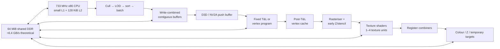
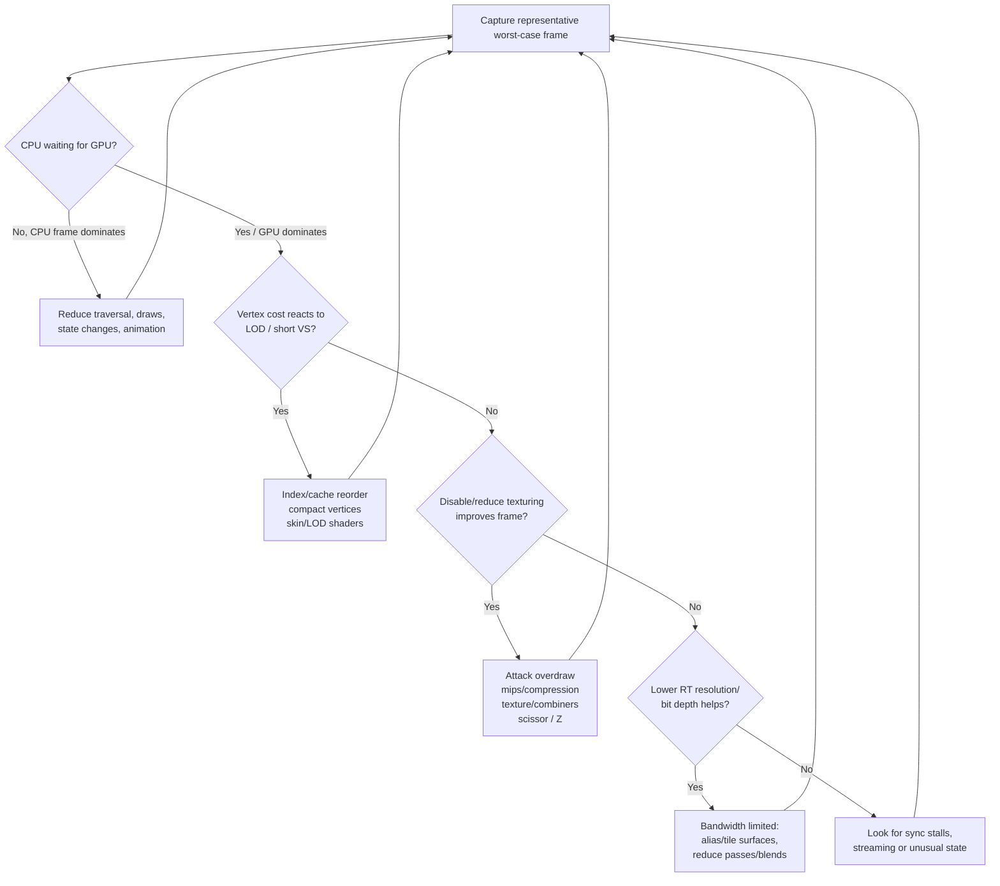

# Original Xbox Rendering Techniques and Engine Optimisation

## Executive summary

The original Xbox is unusually approachable as a sixth-generation console because its rendering architecture is recognisably descended from contemporary PC hardware: a 733 MHz x86 CPU, a custom NVIDIA NV2A GPU closely related to the GeForce3 generation, Direct3D-derived APIs, programmable vertex processing, NVIDIA texture-shader/register-combiner pixel processing, and 64 MiB of unified DDR memory. But treating it as merely a slow PC is a mistake. The machine's defining performance characteristics are **a very small shared memory pool, finite shared memory bandwidth, a weak single CPU core with only 128 KiB of L2 cache, a short post-transform vertex cache, expensive overdraw/multi-pass rendering, and sharply non-linear fragment throughput once several textures or register-combiner stages are used**. Period NVIDIA documentation for the GeForce3 family is therefore extremely useful, but Xbox's unified-memory architecture and custom Direct3D implementation change the optimisation priorities. citeturn21view0turn21view1turn27view1turn27view4

The machine has **64 MiB shared between CPU data, executable code, textures, geometry, render targets, audio and other game state**. Reverse-engineering of Halo 2 shows how aggressively a sophisticated late-generation engine exploited that fact: approximately 49 MiB was reserved into a game-managed pool, while roughly 25 logical render targets were backed by only four or five actual memory allocations through aliasing. GPU-readable resources needed physically contiguous memory, and Halo 2 explicitly marked dynamically managed graphics memory as write-combined. citeturn23view1turn23view2

The most generally valuable optimisations, in descending order, are:

1. **Eliminate tiny draws and redundant state changes.** NVIDIA's contemporary Direct3D advice is literally to “Batch like crazy”; Xbox's lower-overhead runtime does not make CPU work free, and the 733 MHz CPU leaves little budget for thousands of high-level render submissions. citeturn27view8
2. **Use indexed meshes and optimise triangle order for the post-transform cache.** NVIDIA documented a 24-entry physical cache on GeForce3, with an effective working size nearer 18 in its GDC material; a cache hit avoids all transform-and-lighting work. citeturn27view1turn27view6
3. **Reduce vertex bandwidth.** Pack attributes, use the smallest practical formats, keep accesses sequential, and reconstruct data in vertex shaders where worthwhile. NVIDIA explicitly recommended shorter vertex formats and 16-bit packed normals. citeturn27view0
4. **Attack overdraw before making shaders cleverer.** Front-to-back opaque rendering, effective visibility culling, scissoring and, where measurement justifies it, a Z-only pass exploit GeForce3-class early-Z behaviour. NVIDIA explicitly recommended a Z-only pass for fill-rate and bandwidth reduction. citeturn26search1turn27view5
5. **Keep the pixel pipeline short.** On GeForce3-class hardware, one or two textures could run at full texture-addressing rate while three or four could fall to half rate; similarly, one or two register-combiner stages were the fastest case. Halo 2's engine had to introduce a full-screen-sized texture-accumulation intermediate when a material required more than four texture inputs. citeturn27view4turn23view2
6. **Compress, mip and right-size textures.** NVIDIA's period guidance explicitly says to use mipmapping and DXT compression wherever practical and warns that negative LOD bias damages locality. citeturn27view3
7. **Exploit Xbox memory semantics rather than fighting them.** Alias temporary render targets, pool contiguous graphics memory, use write-combined staging/ring buffers, avoid readbacks and locks, and keep the GPU fed through long command/push buffers. Halo 2 and modern open-source `pbkit`/`nxdk-gles11` code provide concrete examples. citeturn23view2turn25search2turn25search23
8. **Do not expect CPU multithreading to provide compute scaling.** The retail machine has one CPU core. The useful parallelism is chiefly **CPU versus GPU versus I/O**, not multiple CPU cores. Rich Geldreich's Shrek-era profiler explicitly visualised CPU/GPU overlap and was used to reorder work to keep the GPU busy. citeturn21view0turn21view3

A particularly important lesson from shipped software is that the Xbox rewarded **whole-frame design**, not isolated micro-optimisation. Shrek implemented deferred shading in 2001 despite the NV2A having neither modern fragment shaders nor multiple render targets; it needed two scene passes to produce its deferred attributes. Geldreich's later *Gladiator* Xbox demo packed the same attributes in one scene pass, explicitly trading precision/encoding complexity for substantially less geometry and bandwidth work. citeturn21view3

The performance percentages later in this report are **engineering estimates for scenes actually limited by the named bottleneck**, not universal benchmark results. A transformation that saves 30% of vertex work will do almost nothing when the frame is fill-rate-bound, and a Z pre-pass can make a low-overdraw scene slower. The recurring rule in every strong period source is therefore: establish whether the limiting resource is CPU submission, vertex processing, fill rate, texture locality, memory bandwidth or synchronisation before choosing an optimisation. NVIDIA's GDC material is structured around exactly that bottleneck-identification methodology. citeturn27view0turn27view2turn27view4

## Hardware and the bottleneck model

### CPU, caches and CPU-to-system bandwidth

The Xbox CPU is a 733 MHz Coppermine-family x86 processor. The console-specific part has **128 KiB of L2 rather than the conventional 256 KiB Coppermine configuration**; the underlying family uses separate 16 KiB instruction and 16 KiB data L1 caches. Its front-side bus runs at 133 MHz; period analysis put the CPU-side theoretical bus bandwidth at approximately **1.06 GB/s**. citeturn21view0turn20search3turn21view1

That matters for rendering in two ways. First, the CPU is fast enough to run considerable game logic but slow by the standards of engines ported from later PC hardware, so per-object traversal, matrix setup, material changes and command submission become visible costs surprisingly quickly. Second, 128 KiB of L2 means render data structures that bounce between large object graphs, matrices, material objects, visibility structures and dynamic geometry can easily lose cache locality. This is why a **flat render queue of compact draw records**, followed by one sorting/batching pass, is a better Xbox architecture than repeatedly chasing high-level scene objects during submission; that recommendation is an engineering inference from the CPU/cache limits and NVIDIA's strong batching guidance. citeturn21view0turn27view8

There is no second CPU core on which to put a parallel renderer. Software threads can still be useful for blocking I/O, audio/control tasks and structuring asynchronous work, but CPU-heavy render preparation merely time-slices the same processor. The important concurrency is letting the CPU prepare future work while the NV2A consumes already-issued work. Rich Geldreich describes building an in-game Xbox CPU/GPU timeline profiler precisely to inspect and maximise that overlap. citeturn21view3

### NV2A and the programmable/fixed-function split

Period measurements describe NV2A running at approximately **233 MHz**, with a theoretical fill rate around **933 million pixels/s** and the ability to apply two textures per pipeline in one pass. The more useful figures, however, are the throughput discontinuities inside the GeForce3-class pipeline: NVIDIA documented that one or two texture operations could sustain the fastest rate, whereas three or four texture stages could require roughly twice as many cycles; one or two register-combiner stages similarly represented the fast case, with progressively lower rate at three/four, five/six and seven/eight stages. citeturn21view1turn27view4

NV2A has a genuinely programmable vertex processor. Reverse-engineered hardware documentation identifies **136 vertex-program instruction slots, 12 general temporary registers plus the output-position alias, and 192 four-component constant registers**. The latter is particularly Xbox-specific: conventional NVIDIA vertex-program interfaces exposed 96 constants, while Microsoft's Xbox interface made another 96 accessible. citeturn21view7

The pixel side needs more careful terminology. Xbox “pixel shaders” are not Shader Model 2-style arbitrary programs. NV2A combines a programmable **texture-shader/addressing unit** with NVIDIA **register combiners**, the latter implementing arithmetic/blending over texture and interpolated inputs. XboxDev's reverse-engineered documentation records NV2A support for the `NV_register_combiners` family with Xbox-specific behaviour. citeturn24search0turn21view8

This architecture explains a seemingly counter-intuitive optimisation: **fixed function is not automatically slower than a vertex program**. NVIDIA's GeForce3 optimisation guide explicitly advised using fixed-function operations where they already did the required work, noting that it could be faster for lighting-heavy cases; custom vertex programs should be used where they eliminate CPU work or enable a better representation—skin deformation, attribute decompression, custom transforms, special lighting, procedural generation and similar jobs. citeturn27view7

### Unified memory, render-target pressure and GPU addressing

Xbox has **64 MiB of unified memory**, not separate system RAM and VRAM. CPU and GPU therefore contend for the same physical memory system, while also gaining the flexibility to refer to common allocations without a conventional PC-style upload into separate VRAM. Period analysis quotes **6.4 GB/s theoretical aggregate memory bandwidth**; one later reverse-engineering project reports that original XDK material warned that usable throughput could be substantially lower and cites roughly 4.5 GB/s as a practical maximum. That 4.5 GB/s number is second-hand because the original proprietary XDK document is not publicly available, so it should be treated as an informed historical report rather than an independently verified specification. citeturn21view1turn23view3

Halo 2's renderer makes the consequences unusually concrete. Xbox GPU resources point at physical memory; the GPU does not walk the CPU's virtual-memory page tables, so graphics allocations that the GPU reads must ultimately map to suitable contiguous physical storage. Halo 2 manually constructed resource headers and registered separately allocated backing memory rather than relying exclusively on ordinary high-level resource creation. citeturn22view0turn23view1

Halo 2 also used aggressive **render-target aliasing**: approximately 25 logical targets for details such as water, reflections, fog and shadows were backed by only about four or five unique allocations whose lifetimes did not overlap. This is one of the strongest concrete Xbox optimisation patterns available publicly because it turns the 64 MiB limit into a resource-lifetime problem instead of simply accepting one allocation per surface. citeturn23view2

The following diagram captures the most useful mental model:



The diagram is a synthesis of the period NVIDIA pipeline material, the documented Xbox unified-memory behaviour and modern NV2A reverse engineering. citeturn21view1turn23view1turn27view1turn27view4

### Practical hardware limits

| Resource / characteristic | Practical figure | Rendering consequence | Source quality |
|---|---:|---|---|
| CPU | 733 MHz Coppermine-family x86 | Submission, culling, animation and scene traversal need very low overhead. | Period secondary; Xbox-specific. citeturn21view0 |
| CPU L2 | 128 KiB | Keep render queues/data compact and sequential. | Period secondary + XboxDev. citeturn21view0turn20search11 |
| CPU FSB | ~1.06 GB/s theoretical | Large CPU-side streaming/geometry churn is undesirable. | Period secondary. citeturn21view1 |
| Main memory | 64 MiB shared CPU/GPU | Textures, geometry, RTs and game state compete directly; aliasing and streaming matter enormously. | Shipped-game reverse engineering. citeturn23view1 |
| Aggregate DDR bandwidth | ~6.4 GB/s theoretical | Overdraw, large RTs, alpha blending and multi-pass materials compete for one bus. | Period secondary. citeturn21view1 |
| NV2A core | ~233 MHz | Limited raw raster budget by modern standards. | Period secondary. citeturn21view1 |
| Theoretical fill | ~933 Mpixel/s | The number is theoretical; texture/combiners/overdraw rapidly lower useful rate. | Period secondary + primary NVIDIA pipeline analysis. citeturn21view1turn27view4 |
| Post-T&L cache | GeForce3: 24 physical; ~18 effective in NVIDIA GDC model | Index ordering is essential. Exact Xbox effective size should be profiled rather than assumed. | Primary NVIDIA; GeForce3-family proxy. citeturn27view1turn27view6 |
| Vertex-program constants | 192 × float4-equivalent register slots | Large matrix/parameter sets can avoid CPU-side rebinding or repeated calculations. | Reverse-engineered Xbox-specific. citeturn21view7 |
| Vertex-program length | 136 instruction slots | Long skinning/lighting programs directly cut vertex throughput. | Reverse-engineered Xbox-specific. citeturn21view7 |
| Pixel texture inputs | Four in Xbox/Halo 2 path | >4 input textures require material decomposition/multi-pass accumulation. | Shipped-engine reverse engineering. citeturn23view2 |
| Multiple render targets | Not available in the modern sense | Shrek needed multiple scene passes for its original G-buffer; later attribute packing reduced this. | Original renderer author. citeturn21view3 |
| Render-target formats | Includes 16-bit and 32-bit colour; Z16 and Z24S8 documented | Choosing narrower formats can save substantial footprint/bandwidth. | Reverse-engineered Xbox-specific. citeturn21view8 |
| Surface layouts | Linear and swizzled; tiling also exists | Layout choice affects sampling/render-target efficiency. | Reverse-engineered Xbox-specific; some wiki sections explicitly marked incomplete. citeturn21view8 |

The last caveat matters: XboxDevWiki is an invaluable community reverse-engineering resource, but several low-level pages themselves mark details as `FIXME`. Where those pages conflict with measurements on real hardware, measurements should win. citeturn21view8

## Rendering techniques and engine optimisations

### Geometry submission, batching and state sorting

**Draw-call batching should be treated as a first-order optimisation.** NVIDIA's Direct3D GDC 2001 material recommends vertex/index buffers for essentially all geometry and repeatedly stresses batching. citeturn27view8

Xbox does not suffer the same thick Windows driver stack as a contemporary general-purpose PC, so it is wrong to transfer a modern “N draw calls per frame” rule mechanically. Nevertheless, each draw still entails CPU traversal, state validation/set-up and command generation. On a 733 MHz core, a renderer that emits separate calls for every wall segment, decal and prop can become CPU-bound long before NV2A is saturated. The better design is to produce compact render packets and merge consecutive packets sharing shader, material, texture set, vertex/index storage and compatible transforms. This is an inference from Xbox's CPU constraints and the period NVIDIA batching guidance. citeturn21view0turn27view8

For static world geometry, batching should usually be spatially bounded rather than global. A giant world mesh minimises draws but destroys culling and LOD granularity; hundreds of tiny batches preserve culling but burn CPU. A useful starting point is sector/cell-sized static batches with enough triangles to amortise submission while remaining individually rejectable.

Opaque state sorting should normally be **hierarchical rather than purely material-sorted**:

`visibility → rough front-to-back depth bucket → expensive shader/material state → texture → mesh`

The depth component improves early rejection, while the material component reduces state churn. NVIDIA explicitly recommends texture sorting and front-to-back use of GeForce3 early-Z. citeturn27view7turn26search1

Transparent objects are the exception: they generally retain back-to-front order where blending correctness requires it, so reducing their pixel coverage and material complexity matters more than perfect batching.

**Estimated impact:** about **5–25% frame-time reduction** in an ordinary CPU/submission-bound engine; pathological “one draw per object” engines can improve substantially more. In a truly GPU-fill-bound scene, batching may change frame time little while still freeing CPU budget. This range is an engineering estimate, not a published Xbox benchmark.

### Index buffers, vertex-cache order and primitive choice

Indexed rendering is not just a memory-space optimisation on this GPU family. NVIDIA states that post-transform caching works with indexed draws and that a hit avoids all transform-and-lighting work. Its GeForce3 documents describe 24 physical cache entries and its GDC pipeline talk describes an effective FIFO-like working set of roughly 18 after pipeline effects. citeturn27view1turn27view6

That leads directly to the mesh-build rule:

> Order triangles so each new triangle overwhelmingly references vertices used in the immediately preceding few triangles.

A Forsyth-style or similar cache optimiser is appropriate even though those algorithms were published around this era; NVIDIA's own recommendation at the time was to use cache-aware tools such as NVTriStrip/D3DX mesh optimisation and to favour recent/sequential reuse. citeturn27view0turn27view1

Triangle strips were useful, but **cache reuse is more important than strip purity**. NVIDIA's OpenGL guidance explicitly says cache hits matter more than primitive type, and its D3D talk still recommends indexed triangle strips as a strong default. citeturn27view6turn27view8

Use **16-bit indices whenever mesh partitioning allows it**. Even without assuming an Xbox-exclusive index format, a 16-bit stream consumes half the index bytes of a 32-bit stream. For large scenery, partitioning naturally into cullable material/spatial batches generally makes the 65,536-vertex addressing range practical.

Avoid creating degenerates simply to join many strips unless doing so demonstrably reduces overall work; NVIDIA warns against excessive degenerate strips because cache and setup behaviour can erase the intended benefit. citeturn27view6

**Estimated impact:** **5–25%** on vertex-processing-limited geometry; larger when source index ordering is exceptionally bad. The best possible improvement is bounded by how many duplicate vertex transformations the old order caused.

### Vertex formats, cache lines and dynamic geometry

NVIDIA's 2002 pipeline presentation makes vertex width unusually explicit: reduce the number of dynamic vertices, shorten the vertex representation, generate attributes in the vertex shader where sensible, compress components and decompress them there, with **16-bit short normals** given as a concrete example. It also recommends sequential vertex use. citeturn27view0

The Xbox version of the reasoning is even stronger than the AGP-PC context in which those slides were presented. Every byte removed from a vertex potentially saves unified-memory traffic and enlarges the useful working set in caches. Typical targets are:

| Attribute | Wasteful representation | Better Xbox-oriented representation |
|---|---|---|
| Position | `float4` | Usually `float3`; quantised local positions are possible when precision allows. |
| Normal | `float3` | Packed/short normal, expanded in VS. NVIDIA explicitly recommended short normals. citeturn27view0 |
| Tangent/binormal | Two or three `float3`s | Pack tangent; reconstruct binormal using normal × tangent and handedness. |
| UV | two 32-bit floats | Short/fixed representation when content range and XDK declaration support it. |
| Colour | four floats | Packed 32-bit colour. |
| Bone indices/weights | full integers/floats | Small integer indices and quantised weights; choose the representation the shader can cheaply decode. |

The exact compressed declaration formats available depend on the XDK/nxdk path used, so content tooling should be driven by the target declaration implementation rather than a generic Direct3D-8 PC assumption.

For frequently rewritten dynamic geometry, use a **ring or multi-buffered allocation**: write sequentially into write-combined memory, submit it, advance to another region and do not recycle the old region until the GPU has consumed it. The analogous NVIDIA guidance warns that CPU writes and GPU reads of the same buffer require synchronisation and recommends fine-grained fencing rather than global finishes. citeturn27view6

**Estimated impact:** reducing a 40-byte vertex to 24 bytes cuts the raw vertex stream by 40%; real frame-time improvement is more likely **3–15% overall**, or **10–30% of a vertex/bandwidth-limited section**.

### Fixed-function T&L, vertex programs and skinning

For ordinary matrix transformation and conventional lighting, test the fixed-function path rather than assuming a handwritten vertex program wins. NVIDIA's GeForce3 guide explicitly says fixed function can be faster for lighting-heavy cases. citeturn27view7

Programmable vertex processing wins when it removes something more expensive elsewhere:

- GPU skinning avoids rewriting a software-skinned vertex stream every frame.
- Packed normals/attributes can be reconstructed as part of transformations already being performed.
- Procedural animation can leave a base mesh static in memory.
- Unneeded operations can be omitted for distant LODs.
- Large constant space can hold substantial matrix/light data with minimal per-vertex memory traffic. NV2A's 192 constant registers are especially useful here. citeturn27view0turn21view7

Vertex-program throughput approximately tracks program length on this generation. NVIDIA summarised it as roughly proportional to `clock_rate / program_length`, making unnecessary instructions particularly expensive. citeturn27view7

A useful skinning hierarchy is therefore:

`rigid → 1 bone → 2 bones → 3/4 bones only near camera`

rather than running the highest-quality skinning shader on every LOD. NVIDIA's own performance guidance recommends shader LOD and reducing unnecessary distant work. citeturn27view5

**Estimated impact:** moving expensive CPU skinning/T&L to an efficient vertex path can recover **10–40% of CPU time** in animation-heavy scenes; replacing one reasonable GPU vertex path with another typically yields much smaller whole-frame changes.

### Early-Z, front-to-back ordering and Z pre-pass

GeForce3 introduced effective early depth rejection: fragments hidden by previously written depth can be rejected before expensive texture/fragment work. NVIDIA later described the distinction clearly: early-Z rejects fragments in rasterisation; occlusion culling rejects entire geometry before its ordinary rendering work. citeturn26search1

For opaque geometry, **rough front-to-back ordering is almost free performance** when overdraw exists. It need not be a perfect distance sort; a handful of depth buckets inside spatial/material groups often captures most of the benefit without turning sorting itself into a CPU problem.

NVIDIA's own 2002 recommendation is unusually direct: **render a Z-only pass first**, because depth optimisations happen before later raster work and the pass can save memory bandwidth. citeturn27view5

On Xbox, however, a universal Z-prepass is not automatically correct. It doubles vertex submission/transform and depth traffic for geometry that participates. When the subsequent material consists of one cheap texture and one or two combiners, the cost of drawing geometry twice may exceed the saved shading. Conversely, foliage-heavy scenes, multi-textured environments, deferred light passes or expensive bump/environment-mapped surfaces can benefit substantially.

A good policy is:

```text
if opaque_overdraw is high
and pixel/material cost is high
and vertex cost is moderate:
    test depth pre-pass
else:
    preserve normal front-to-back opaque rendering
```

**Estimated impact:** front-to-back ordering commonly has **5–20% upside** in fill-bound scenes. A full Z pre-pass has a plausible range from roughly **10% slower to 30% faster** depending on geometry cost, overdraw and material complexity. Those are engineering ranges; profile the actual frame.

### Occlusion culling

GeForce3-class GPUs contain hardware support for occlusion querying, and NVIDIA's later GPU Gems treatment traces GPU occlusion-query support back to GeForce3. citeturn26search1

What I did **not** find in a lawful public primary Microsoft source is a definitive original-Xbox-XDK API contract establishing which query path shipped and under what restrictions. Therefore, for an engine intended to work across XDK versions or nxdk, I would not design the visibility architecture around synchronous GPU queries without first verifying the target API and real hardware.

A stronger baseline on this CPU/GPU is coarse CPU-side visibility:

`frustum → portal/PVS/sector → distance/LOD → optional hierarchical occlusion → draw`

Indoor BSP/portal engines and corridor-heavy games can remove entire rooms and material batches before touching the GPU. Outdoor games benefit from hierarchical terrain/object cells and conservative occluder sets.

Where an occlusion-query path is available, avoid reading each result immediately after issuing it; that destroys CPU/GPU overlap. Consume older results conservatively and assume visible when uncertain. That is consistent with NVIDIA's asynchronous-query recommendations for this hardware lineage. citeturn26search1

**Estimated impact:** near zero in open vistas with little occlusion, but **10–50% or more** in strongly occluded indoor scenes if it eliminates expensive batches. CPU cost can negate the benefit when objects are tested too individually.

### Geometry and shader LOD

LOD should reduce **all three expensive domains**, not just triangle count:

- fewer vertices;
- cheaper vertex work, especially fewer skinning influences;
- cheaper pixel materials, for example removing detail maps or secondary environment/bump contributions.

NVIDIA explicitly advised “shader LODing” and turning off distant detail-map computation. citeturn27view5

Because tiny distant triangles can still create substantial setup and aliasing pressure while high-frequency textures cause cache-unfriendly accesses, the ideal Xbox LOD transition combines geometry simplification with smaller/mipped texture use and a simpler material.

**Estimated impact:** **10–40% in geometry-heavy scenes** is realistic when the original engine uses one representation at all distances; more is possible in vast outdoor environments. Poor thresholds cause popping and CPU churn, so use hysteresis and preferably asset-authored transitions.

### Scissor rectangles, viewport restriction and reduced-resolution passes

A scissor rectangle has outsized value for **localised effects** because NV2A fill cost is determined by the fragments touched and the work done per fragment. NVIDIA's fill-rate documentation identifies fragment count, texture fetching and blending as the principal drivers. citeturn27view2

Useful applications include:

- restrict local-light accumulation to the light's projected screen bounds;
- restrict shadow/fog/reflection compositing to affected regions;
- limit clears or post-processing to actual surfaces;
- render mirrors/reflections/shadow maps at smaller viewports when full resolution does not improve perceived quality.

This is especially attractive in a deferred-lighting design such as Geldreich's Xbox work, where each light otherwise risks processing a large screen region. His Shrek/Gladiator work demonstrates how strongly performance depended on reducing scene passes and light cost. citeturn21view3

The gain is approximately proportional to eliminated pixel work when the affected pass is fill-bound. **Estimated whole-frame benefit: 5–30%** in engines with many local lights/reflections/shadows; negligible in simple forward scenes.

### Texture formats, DXT, mipmaps and filtering

NVIDIA's contemporary recommendation is unequivocal: use mipmapping, DXT compression where practical, the smallest texture that meets the visual requirement and the smallest sufficient format. Negative LOD bias is discouraged because it both aliases and degrades cache locality. citeturn27view3

Mipmaps are not primarily a visual-quality luxury on Xbox. They reduce the footprint sampled for distant surfaces and therefore improve texture-cache locality and unified-memory bandwidth. A full mip chain consumes extra storage, but frequently *reduces the bytes fetched per visible pixel*, which is the more important quantity during play.

Do not default everything to 32-bit colour. XboxDev's documented render-surface list contains both R5G6B5-class and 32-bit formats, and the same principle applies broadly to textures: masks, light data and low-dynamic-range intermediates often need fewer bits than albedo. citeturn21view8

Filtering needs to be chosen with measurements rather than modern expectations. In NVIDIA's GeForce3-class microbenchmarks, trilinear filtering could halve fill throughput in relevant cases; the exact cost depends on material configuration and cache behaviour. citeturn27view3

Most important is **texture-stage count**. NVIDIA measured:

| Pixel configuration, GeForce3-class | Isolated throughput behaviour |
|---|---|
| 1–2 texture operations | Fast/full-rate case |
| 3–4 texture operations | About half of that addressing rate |
| 1–2 register combiners | Fast/full-rate combiner case |
| 3–4 combiners | About half |
| 5–6 combiners | About one third |
| 7–8 combiners | About one quarter |

These are synthetic pipeline characteristics, not claims that an Xbox game becomes exactly twice as fast by deleting two textures. They explain why material simplification can nevertheless produce large nonlinear gains. citeturn27view4

Halo 2 is a real shipped example. Its Xbox path could directly sample four textures per pixel-shader pass; materials exceeding that budget first accumulated detail textures into a `texaccum` target, then consumed that result along with bump/lightmap data in another pass. The cost is not merely an extra shader: the intermediate is written, then read again through the shared memory system. citeturn23view2

**Estimated impact:** compression/mip/format work usually gives **5–25%** where texture traffic is important plus significant memory-capacity savings. Dropping a material from a 3–4-texture throughput tier into the 1–2-texture tier can approach a 2× gain for the isolated fragment portion, while whole-frame gains are more commonly **5–30%**.

### Swizzling, tiling and render-target layout

Xbox surfaces can be linear or swizzled, with additional tiling mechanisms documented by the reverse-engineering community. The precise performance rules vary by use and some XboxDevWiki notes remain incomplete, so this is an area where real-hardware benchmarking is essential. citeturn21view8

A rare concrete measurement comes from the 2024 Halo 2 HD reverse-engineering project. After other bottlenecks had been removed, converting the enlarged `texaccum` render target to a tiled configuration yielded about **one to two additional frames per second** in its demanding Zanzibar test, bringing that particular modified test from roughly 22 FPS to approximately 23–24 FPS. This is not directly transferable to 640×480 retail rendering, but it proves that render-target layout can materially affect NV2A once the frame is bandwidth/fill limited. citeturn23view0turn23view2

### Streaming and memory residency

With only 64 MiB, an advanced engine should assume that not all highest-detail assets remain resident. Halo 2's allocation was explicitly partitioned into caches for textures, geometry, animation and other systems; its reverse-engineered memory profile shows how little truly unused space remained. citeturn23view1

A robust Xbox streamer should therefore operate in coarse priority layers:

```text
always-resident:
    renderer core, fallback textures, critical character data

scene-resident:
    cell/room geometry, common material sets, local animation

streamed:
    high mips, distant-to-near geometry, uncommon effects

temporary:
    frame/intermediate buffers with aggressively reused lifetimes
```

The highest-value streaming optimisation is usually avoiding a stall, not maximising raw disk throughput. Load before visibility when the level structure permits it; use low-resolution texture representations as fallbacks; keep memory pools predictable; and do decompression/work in chunks small enough that the single CPU does not cause a visible frame spike.

Because there is no second CPU core, a “streaming thread” does **not** give free decompression compute. It helps when the thread blocks on I/O; expensive decompression still consumes cycles that would otherwise execute game/render work.

**Estimated effect:** often little change in average FPS but dramatically fewer stalls and the ability to use higher-quality content without exhausting RAM. Poor streaming can dominate perceived performance even with a fast average frame.

### Memory layout, write combining and render-target aliasing

This is one of the most Xbox-specific optimisation areas.

Halo 2 demonstrates direct resource backing:

```c
pRenderTarget->Register(pSurfaceBuffer);
```

The resource header and backing allocation could therefore be managed separately, facilitating memory aliasing and custom layouts. citeturn23view2

Its dynamic/graphics memory management also includes the essential write-combined pattern:

```c
pPhysicalAllocPtr |= PHYSICAL_MEM_ADDRESS_MASK;
XPhysicalProtect(pPhysicalAllocPtr, allocationSize,
                 PAGE_READWRITE | PAGE_WRITECOMBINE);
```

That is reconstructed C from Halo 2's retail binary, not original Bungie source, but it captures the engine's observed memory policy. citeturn23view1

For an engine, the practical rules are:

**Allocate big pools early.** Suballocate vertex, index, texture-streaming and transient-render memory rather than repeatedly seeking large contiguous blocks late in a level's lifetime. This reduces fragmentation risk arising from the GPU's physical-memory requirements. citeturn23view1

**Never casually read back from write-combined GPU-facing memory.** Period NVIDIA advice for analogous mapped graphics regions is emphatic that they should be written sequentially and not CPU-read; such reads defeat the memory policy and can be extremely slow. citeturn27view6

**Alias transient surfaces by lifetime.** Halo 2's ~25 logical targets backed by four or five allocations is the canonical public Xbox example. citeturn23view2

**Prefer ping-pong/ring allocations to lock/wait/update.** NVIDIA's D3D guidance explicitly warns against frequent buffer/framebuffer/depth locks and advocates VBs/IBs and batching. citeturn27view8

Memory aliasing may produce **zero immediate FPS** while still being one of the platform's biggest wins: several megabytes reclaimed can prevent texture thrashing, enable larger cache budgets or eliminate a streaming transition. Its performance effect is thus often indirect.

### Push buffers, DMA and Xbox-specific APIs

The modern open-source `nxdk` project is the best legally accessible replacement for studying low-level Xbox command submission. It contains `lib/pbkit`, described as a low-level library for interfacing with the Xbox GPU; its toolchain also contains vertex- and pixel-program compilers. citeturn25search0turn27view9

`pbkit.c` exposes the push-buffer model directly. Even a tiny fragment of its state shows the design:

```c
static DWORD pb_Size = PBKIT_PUSHBUFFER_SIZE;
```

The file also manages physically contiguous DMA buffers and a GPU push-buffer head, making it valuable for understanding what lies beneath Xbox Direct3D. citeturn25search2

Modern `nxdk-gles11` gives another concrete implementation clue: it stages ordinary client arrays into **physically contiguous GPU-accessible memory** before issuing rendering because NV2A DMA cannot consume arbitrary pageable CPU allocations directly. citeturn25search23

The important optimisation lesson is not “rewrite everything in pbkit”. Microsoft's Xbox D3D layer already provided a specialised console runtime. The lesson is that GPU work ultimately becomes a sequential command stream. Therefore:

- reserve/write commands in chunks instead of emitting tiny fragments;
- minimise state reprogramming;
- avoid CPU/GPU synchronisation points;
- use persistent/static GPU-readable data where possible;
- use ring-buffered dynamic data;
- keep enough work queued that NV2A does not starve.

A custom push-buffer renderer is justified when an engine wants very fine control or is using nxdk without the proprietary XDK. For a conventional XDK title, rewriting mature D3D code around raw methods would generally be a high-risk late-stage optimisation.

### Shader and assembly-level optimisation

`nxdk` supplies `vp20compiler` and `fp20compiler`; the former turns NVIDIA-style vertex-program assembly into NV2A microcode and the latter handles register-combiner/fragment descriptions for Xbox command submission. citeturn27view9turn25search5

The build system makes this explicit:

```make
VP20COMPILER = $(NXDK_DIR)/tools/vp20compiler/vp20compiler
FP20COMPILER = $(NXDK_DIR)/tools/fp20compiler/fp20compiler
```

citeturn25search5

Period NVIDIA advice for vertex assembly was to exploit swizzles and write masks, question unnecessary `MOV`s and put useful lookup/precomputed data into constant registers rather than recomputing it per vertex. NV2A's unusually large 192-register constant space makes that particularly attractive. citeturn21view7turn7view0

Good NV2A shader assembly therefore tends to:

1. fuse operations through swizzles/masks rather than moving components into temporary registers;
2. precompute invariant matrix/light terms on the CPU once per object or batch, not once per vertex;
3. reconstruct compressed attributes only when the saved bandwidth outweighs instructions;
4. generate cheap derived values instead of fetching another vertex attribute;
5. build several quality variants instead of one maximal shader;
6. avoid adding texture stages casually on the pixel side because stage count has step-function throughput costs. citeturn27view0turn27view4

An advanced Xbox-specific use is **attribute packing across pixel combiner outputs**. Geldreich's *Gladiator* deferred renderer compressed the deferred attributes enough to output them in one scene pass, while Shrek's original implementation needed two full scene passes. On a machine with shared bandwidth, no modern MRTs and expensive multi-pass materials, that is exactly the sort of representation change capable of producing a structural rather than incremental optimisation. citeturn21view3turn22view1

## Code, samples, talks and shipped-engine evidence

### Primary and near-primary technical material

The strongest period documentation I found is NVIDIA's material for the same GPU generation.

| Source | What it contributes | Relevance |
|---|---|---|
| [NVIDIA GDC 2002 — *Balancing the Rendering Pipeline / Graphics Performance*](https://developer.download.nvidia.com/assets/gamedev/docs/GDC2002_PipePerformance.pdf) | Vertex width, post-T&L cache, shader length, texture-cache behaviour, DXT/mips, texture/combiner throughput, Z pre-pass, bandwidth diagnosis. citeturn27view0turn27view1turn27view3turn27view4turn27view5 | **Highest-value generic NV2x optimisation source.** It is GeForce3/4-oriented rather than an Xbox XDK document, so AGP-specific advice must be translated to Xbox UMA. |
| [NVIDIA — *GeForce3 OpenGL Performance*](https://developer.download.nvidia.com/assets/gamedev/docs/OpenGLPerf.pdf) | 24-entry physical post-T&L cache, synchronization, fixed-function versus vertex program, texture/state sorting. citeturn27view6turn27view7 | Primary NVIDIA microarchitecture guidance. |
| [NVIDIA GDC 2001 — *D3D Optimization*](https://developer.download.nvidia.com/assets/gamedev/docs/GDC2001_Optimization.pdf) | Indexed strips, VBs/IBs, lock avoidance and aggressive batching. citeturn27view8 | Excellent CPU/submission guidance for Xbox-era Direct3D engines. |
| [Rich Geldreich — Early History of Deferred Shading](https://sites.google.com/site/richgel99/the-early-history-of-deferred-shading-and-lighting) | Direct account of Shrek Xbox, its deferred renderer, GPU profiling and subsequent *Gladiator* work. citeturn21view3 | Near-primary: written by the renderer author. |
| [GDC 2004 deferred-shading presentation mirror](http://www.subquantumtech.com/gdc_2004_deferred_shading.ppt) | Attribute packing, deferred shading/lighting on Xbox and later hardware. The original GDC link is no longer working according to Geldreich. citeturn21view3 | Important historical Xbox-specific talk; mirror provided by the author. |
| [Xbox 1 G-buffer attribute-packing shader](https://sites.google.com/site/richgel99/the-early-history-of-deferred-shading-and-lighting/xbox-1-g-buffer-attribute-packing-pixel-shader) | Concrete NV2A combiner-era shader from the *Gladiator* work. citeturn22view1 | Rare public Xbox-specific shader artefact. |

One particularly useful visual in NVIDIA's GDC 2002 deck is the set of slides showing how vertex representation and texture-stage count alter throughput. The deck's later slides explicitly illustrate the one/two versus three/four texture throughput step and the Z-prepass recommendation. citeturn8view0turn8view3turn8view5

### Open-source Xbox GPU code and samples

| Project / location | Useful code | What to inspect |
|---|---|---|
| [XboxDev/nxdk](https://github.com/XboxDev/nxdk) | `samples/`, `lib/pbkit/`, `tools/vp20compiler/`, `tools/fp20compiler/` | Best public general-purpose original-Xbox SDK; provides modifiable GPU stack and samples. citeturn27view9 |
| [`nxdk/lib/pbkit/pbkit.c`](https://github.com/XboxDev/nxdk/blob/master/lib/pbkit/pbkit.c) | Low-level command/DMA/push-buffer management | Study command-buffer allocation, GPU channel state and low-level submission. citeturn25search2 |
| [Ryzee119/nxdk-gles11](https://github.com/Ryzee119/nxdk-gles11) | OpenGL ES 1.1-style translation layer on pbkit | Excellent example of state translation and staging arbitrary vertex arrays into contiguous GPU-visible storage. citeturn25search23 |
| [fgsfdsfgs/pbgl](https://github.com/fgsfdsfgs/pbgl) | Partial OpenGL 1.x implementation | Another small, readable high-level-to-NV2A layer. citeturn25search3 |
| [Voxel9/xbox-xgu-examples](https://github.com/Voxel9/xbox-xgu-examples) | Stand-alone GPU examples using nxdk/xgu | Useful when a full engine hides too much of the command path. citeturn25search6 |
| [XboxDev/nv2a-trace](https://github.com/XboxDev/nv2a-trace) | GPU command-stream tracing | Inspect methods and intermediate rendering state; valuable for shipped-binary archaeology and emulator comparison. |
| [raylib4Xbox](https://github.com/Memorix101/raylib4Xbox) | `rcore_xbox.c`, `nxdk-gles11` integration | Shows a current real-hardware engine port translating high-level GL 1.1 calls to NV2A pushbuffers. citeturn21view6 |
| [XboxDev organisation](https://github.com/XboxDev) | nxdk, tracers, Xbox research tools | Central repository collection for legally redistributable community work. citeturn25search19 |
| [Awesome Xbox Development](https://xbox1.dev/) | Curated catalogue | Convenient index of toolchains, emulators, docs and libraries. citeturn25search28 |

`raylib4Xbox` is useful as an implementation example, but one statement in its README describes NV2A as effectively “fixed-function-era”. That should not be interpreted literally as absence of programmable shaders: NV2A has a programmable vertex unit and configurable texture/register-combiner pixel pipeline, as demonstrated by the XboxDev shader documentation and `nxdk` toolchain. citeturn21view6turn21view7turn24search0

### Shipped-engine archaeology

The best detailed public retail-engine case study I found is Ryan Miceli's 2024 reverse engineering of Halo 2. The author reconstructed assembly into C and explicitly labels the code that way, so it should not be mistaken for a Bungie source release. citeturn22view0

The study reveals several practices of direct relevance to an Xbox renderer:

| Halo 2 behaviour | Lesson |
|---|---|
| ~49 MiB game-managed initial memory region | Fixed pools made the retail memory budget predictable. citeturn23view1 |
| ~25 logical render targets on ~4–5 backing allocations | Alias transient targets by non-overlapping lifetime. citeturn23view2 |
| Manual `XGSetTextureHeader` and `Register()` use | Separate resource metadata from physical backing to reuse memory. citeturn23view2 |
| Physical, contiguous graphics allocations | Design GPU memory arenas early to avoid fragmentation. citeturn23view1 |
| Write-combined graphics allocations | Dynamic CPU→GPU streams should be sequential write-mostly memory. citeturn23view2 |
| Four-texture limit led to `texaccum` multi-pass materials | Material complexity directly generates additional RT bandwidth and overdraw. citeturn23view2 |
| Tiling the enlarged `texaccum` produced +1–2 FPS in the modified HD benchmark | Surface layout is a measurable performance parameter. citeturn23view0 |
| Enlarging the frame for true 720p exhausted retail memory without RAM modifications | Resolution affects both fill/bandwidth **and** capacity on UMA. citeturn23view4turn23view1 |

The HD experiment also provides a useful lesson about diagnosing limits: after removing a GPU/CPU synchronisation-related swap stall, performance rose by roughly 10% in the selected benchmark and the GPU became clearly saturated, allowing subsequent optimisation to target the correct component. citeturn23view0

### Shrek, deferred shading and GPU utilisation

Geldreich's account is particularly important because it is not emulator reconstruction: he wrote Shrek's deferred renderer and NV2A combiner setup. He describes using an asynchronous Xbox GPU callback mechanism plus CPU timestamping to create a two-column CPU/GPU profiler and then rearranging rendering to maximise GPU utilisation. citeturn21view3

Shrek's deferred path needed **two full scene passes** to generate the required G-buffer-style information because Xbox lacked multiple render targets. His subsequent *Gladiator* implementation packed attributes so the same broad deferred setup could begin from a **single scene pass**, permitting more lights and/or geometry for the available frame budget. citeturn21view3

The deeper lesson is not “use deferred rendering on every Xbox game”. Forward shading is often substantially cheaper on NV2A. The lesson is that **reducing passes can outweigh arithmetic complexity**, because every extra pass potentially repeats transformations, rasterisation, depth traffic, render-target writes and later texture reads over the same shared 6.4 GB/s theoretical memory interface. citeturn21view1turn27view5

### Availability of Microsoft's original XDK sources

I did **not** find a legitimate current Microsoft-hosted archive of the original Xbox XDK documentation and samples. Microsoft's current public game-development resources are aimed at modern GDK/Xbox One/Series development, while projects such as OXDK explicitly state that they do not distribute Microsoft's XDK and require a user to provide their own copy. citeturn25search22turn25search14

Consequently this report deliberately does **not** link leaked XDK archives. Where original-XDK behaviour is discussed, I have preferred period NVIDIA material, an original Xbox rendering author, retail-binary reverse engineering, and the clean/open XboxDev ecosystem.

## Comparative optimisation matrix

The estimates below answer the “how much does this matter?” question in an engine-design form. They are not claimed measured averages. “Expected gain” means a plausible **whole-frame** improvement when the identified bottleneck is materially present; “isolated” means the affected pipeline stage can improve more than the whole frame.

| Technique | Why it matters on Xbox | Implementation notes | Main trade-off | Expected gain when applicable |
|---|---|---|---|---:|
| **Draw-call batching** | 733 MHz CPU; per-draw setup consumes CPU budget. NVIDIA says to batch aggressively. citeturn21view0turn27view8 | Merge material-compatible static meshes; instance-like repeated objects where engine permits; submit compact render packets. | Large batches weaken culling. | **5–25%**, potentially larger in pathological engines. |
| **State/material sorting** | Fewer texture/shader state changes and better command locality. NVIDIA specifically recommends texture sorting. citeturn27view7 | Sort visible packets by opaque depth bucket + material/texture. | Perfect state ordering can hurt early-Z. | **2–15%**. |
| **Front-to-back opaque draw** | Feeds early-Z before expensive texture/combiner work. citeturn26search1 | Coarse depth buckets usually sufficient. | Conflicts somewhat with material sorting. | **5–20%** in overdraw-heavy scenes. |
| **Indexed geometry** | Enables post-T&L cache; hits avoid all T&L work. citeturn27view1 | Use IBs universally for reusable vertices. | Mesh partitioning/tooling. | **5–20%** vertex-bound. |
| **Vertex-cache reordering** | Effective GeForce3-family cache working set is short. citeturn27view1turn27view6 | Reorder triangles for recent reuse; reorder VB accordingly. | Offline build complexity only. | **5–25%** vertex-bound; high ROI. |
| **16-bit indices** | Half the index-stream size versus 32-bit representation. | Partition meshes into manageable batches. | More batches if mesh partitioning is poor. | **0–5% frame**, mainly bandwidth/capacity. |
| **Compact vertex formats** | Shared-memory bandwidth and cache footprint. NVIDIA explicitly recommends attribute compression. citeturn27view0 | Packed normals, compact UVs/weights/colours; reconstruct where cheap. | Precision + VS instructions. | **3–15% frame**, **10–30%** vertex stage. |
| **Static/dynamic separation** | Avoid rewriting static attributes just because one stream changes. NVIDIA notes mixed static/dynamic interleaving inefficiency. citeturn27view6 | Separate streams or separate meshes according to update frequency. | More bindings/state. | **2–10%** dynamic-heavy. |
| **Fixed-function T&L for conventional work** | GeForce3 FFP can outperform custom vertex code for lighting-heavy conventional cases. citeturn27view7 | Benchmark FFP against equivalent short VS. | Less flexibility. | **0–20%** vertex-stage dependent. |
| **GPU skinning / VS animation** | Saves CPU work and dynamic VB bandwidth. NVIDIA explicitly suggests VS animation of otherwise static buffers. citeturn27view0 | Bone-count LOD; batch same skeleton/shader policy. | VS cost, constant usage. | **10–40% CPU** in character-heavy scenes. |
| **Shader LOD** | Pixel and vertex instruction counts matter directly. citeturn27view5 | Remove detail layers, reduce bones/lights with distance. | Visual transition quality. | **5–25%** in complex scenes. |
| **Geometry LOD** | Reduces vertex work and often coverage of small/degenerate triangles. | Hysteresis; simplify material too. | Asset/tool cost, popping. | **10–40%** geometry-bound. |
| **Portal/PVS/sector culling** | Removes CPU submission + vertex + pixel work entirely. | Coarse cells first; objects second. | Memory/precomputation; weak outdoors. | **10–50%+** in occluded worlds. |
| **GPU occlusion queries** | GeForce3-family hardware supports them. citeturn26search1 | Verify XDK/nxdk exposure; consume asynchronously. | Query overhead/stalls; public Xbox API evidence incomplete. | Scene-dependent; **0–30%**. |
| **Z pre-pass** | NVIDIA specifically recommends it for early depth rejection/bandwidth. citeturn27view5 | Opaque, expensive materials only; profile. | Doubles geometry/depth work. | **−10% to +30%**. |
| **Scissor/local viewport** | Directly reduces fragment count for local lights/effects. citeturn27view2 | Compute screen bounds; use for lights/shadows/reflections. | CPU bounds calculation. | **5–30%** in affected engines. |
| **Lower-resolution RTs** | RT resolution is a major bandwidth term. NVIDIA lists resolution/bit-depth among bandwidth drivers. citeturn27view5 | Half/quarter-res fog/reflections/etc. | Quality. | **5–25%** when such passes dominate. |
| **DXT compression** | NVIDIA explicitly recommends it to reduce texture pressure. citeturn27view3 | Compress albedo/detail where artefacts acceptable. | Block artefacts, unsuitable data types. | **5–20%** texture-bound + major capacity gain. |
| **Mipmapping** | Cuts distant texture footprint/cache misses; explicitly recommended. citeturn27view3 | Generate good offline mip chain; sensible LOD. | ~extra asset storage for mip chain. | **5–20%** texture-bound. |
| **Avoid excessive trilinear/aniso** | NVIDIA measured potentially substantial filtering-rate cost. citeturn27view3 | Reserve quality filtering for surfaces that benefit. | Image quality/shimmer. | **0–20%** fill-bound. |
| **Reduce texture stages** | 3–4 texture operations can occupy twice the throughput slot of 1–2 on GeForce3-class hardware. citeturn27view4 | Bake layers, shader LOD, combine textures/materials. | Memory/art flexibility. | **5–30% frame**; up to ~2× isolated fragment work. |
| **Reduce register-combiner stages** | Throughput declines in stage-count tiers. citeturn27view4 | Algebraically simplify/fold operations; pre-bake constants. | Precision/functionality. | **5–25%** affected materials. |
| **Swizzle/tile appropriately** | Layout changes cache/memory behaviour. Halo 2 HD measured +1–2 FPS from tiling one major RT. citeturn23view0turn21view8 | Benchmark textures separately from render targets. | Format/layout restrictions. | **0–10%**, occasionally more. |
| **Render-target aliasing** | 64 MiB capacity is severe; Halo 2 mapped ~25 logical RTs to ~4–5 allocations. citeturn23view2 | Build lifetime graph; pool max-compatible extents/formats. | More complicated resource management. | Often **capacity rather than FPS**; can prevent thrashing. |
| **Contiguous GPU arenas** | GPU consumes physical addresses; fragmentation can prevent allocations. citeturn23view1 | Allocate large pools early, suballocate. | Less general allocator flexibility. | Reliability + reduced allocator overhead. |
| **Write-combined dynamic buffers** | Xbox/Halo 2 explicitly uses write-combined graphics storage. citeturn23view2 | Sequential writes; never CPU-read hot GPU memory. | Reads are poor. | **3–15% CPU** on dynamic-heavy rendering. |
| **Ring-buffer streaming** | Avoid CPU waiting for GPU on shared dynamic memory; analogous NVIDIA guidance advocates fine-grained sync. citeturn27view6 | Several frames/regions in flight. | Extra memory. | **5–20% CPU** if stalls existed. |
| **Push-buffer batching** | NV2A ultimately consumes a sequential command stream; pbkit exposes this directly. citeturn25search2 | Reserve large command regions; minimise flush/wait. | Low-level complexity. | **5–20% CPU** in submission-heavy custom renderers. |
| **CPU threads for rendering** | One CPU core means no parallel compute scaling. | Use threads mainly to hide blocking I/O; prioritise CPU/GPU overlap. | Context switching/locks can worsen performance. | **≈0% compute gain**; can reduce hitches. |
| **VS assembly optimisation** | Vertex throughput scales with program length; NV2A has finite slots/registers. citeturn27view7turn21view7 | Swizzles/masks, remove MOVs, constants for precomputed terms. | Less maintainable assembly. | **2–15%** vertex-bound. |
| **Pass/attribute packing** | Avoids entire extra scene/render-target passes. Shrek→Gladiator is the concrete Xbox example. citeturn21view3 | Pack normals/material data into available channels/combiners. | Precision and complexity. | Potentially **large, 10–30%+** in multi-pass renderers. |

## Prioritised practical optimisation programme

The most effective way to optimise an unknown Xbox engine is not to start with assembly. It is to force the engine through a sequence that identifies and removes structural waste first.



This diagnostic flow mirrors NVIDIA's period method: alter one major resource—vertex size/work, textures/fill, resolution/bandwidth—and observe whether frame time moves. citeturn27view0turn27view2turn27view4turn27view5

### Immediate, low-risk work

| Priority | Change | Effort | Expected return |
|---|---|---:|---:|
| **Highest** | Instrument CPU frame sections and GPU completion/idle behaviour. Count draws, triangles, transformed vertices, texture switches, material passes and visible pixels/overdraw proxies. Rich Geldreich's Xbox work demonstrates the value of viewing CPU/GPU timelines rather than only FPS. citeturn21view3 | Medium | Enables every later gain. |
| **Highest** | Batch small static draws and eliminate redundant state sets. | Low–Medium | **5–25%** CPU-bound. |
| **Highest** | Make every reusable mesh indexed; run post-transform-cache optimisation offline. | Low | **5–25%** vertex-bound. |
| **Highest** | Opaque rough front-to-back ordering while retaining broad material grouping. | Low | **5–20%** fill-bound. |
| **Highest** | Ensure all world/character textures have appropriate mips; compress/right-size them. NVIDIA explicitly recommends all three. citeturn27view3 | Low–Medium | **5–25%** texture-bound + memory. |
| **Highest** | Audit texture-stage and combiner counts per material. Flag 3–4-texture and >2-combiner materials for review. citeturn27view4 | Low | Can expose **large** material hotspots. |

For most engines these first changes offer a better risk/reward ratio than replacing the rendering API.

### Medium-effort structural changes

Next, compact the vertex formats and split static versus dynamic data appropriately. Use packed normals/weights/UVs where the available Xbox declaration path supports them, then expand them cheaply in the vertex shader. NVIDIA explicitly recommends this bandwidth-for-ALU trade. citeturn27view0

Convert dynamic buffers to sequential, write-combined ring allocations rather than “lock, overwrite, wait”. Build large physical/contiguous pools at level startup and suballocate GPU-facing resources. Halo 2's memory organisation is strong evidence for both practices. citeturn23view1turn23view2

Introduce LOD as a **material-and-animation system**, not merely a polygon reducer. A distant character should have fewer vertices, fewer bone influences and a cheaper material. A distant wall should not retain a detail map whose texels are sub-pixel. NVIDIA explicitly recommends shader LOD and removing distant detail-map computation. citeturn27view5

For world visibility, introduce broad-phase cells/portals/PVS before per-object culling if the level structure supports them. Do not run sophisticated occlusion tests on hundreds of individual tiny props when one room/cell test can suppress the entire set.

Add scissor bounds to expensive screen-space local effects and reduce off-screen/intermediate resolution aggressively. On a 640×480-class target, a half-resolution pass has one quarter as many pixel positions; visual results often survive bilinear upsampling far better than an extra full-resolution effect survives the frame budget.

### High-effort, high-reward changes

Implement render-target lifetime aliasing if the engine has many post-effect, reflection, shadow, deferred or accumulation buffers. Halo 2 demonstrates an extreme but production-proven form of this approach. citeturn23view2

Rewrite especially expensive multi-pass materials to stay inside the one/two-texture and one/two-combiner fast cases where artistic requirements permit. Do not merely shorten each pass—question whether the pass needs to exist. The nonlinear stage-rate behaviour makes pass elimination disproportionately valuable. citeturn27view4

Only after measuring persistent overdraw should a general depth pre-pass be added. NVIDIA recommends the method, but it must beat the cost of sending the opaque world through the vertex/depth path twice. citeturn27view5

For specialised lighting engines, consider representation changes such as Geldreich's packed deferred attributes rather than reproducing a modern G-buffer architecture literally. Xbox lacks modern MRTs and fragment programmability; the successful historical solution was to adapt the algorithm to the machine. citeturn21view3

### Suggested first implementation sprint

For an engine whose present architecture is unknown, I would execute the work in this order:

| Order | Deliverable | Approximate engineering effort | Success criterion |
|---:|---|---|---|
| A | Frame profiler + counters for draw calls, triangles, states, per-pass times | 2–5 days | Can identify CPU, vertex, fill/bandwidth or synchronisation bottleneck. |
| B | Opaque render queue + material/state keys + front-to-back buckets | 3–7 days | Lower CPU render time and/or overdraw without visual change. |
| C | Offline index-cache optimiser | 1–3 days | Fewer unique VS invocations / faster geometry-heavy frame. |
| D | Texture audit: mips, compression, dimensions, stage count | 3–10 days + art processing | Smaller resident set and lower texture-bound frame time. |
| E | Compact static vertex declarations | 3–10 days | Lower vertex-buffer footprint/bandwidth with acceptable precision. |
| F | Dynamic VB ring + write-combined/contiguous allocator | 3–7 days | Eliminate GPU waits caused by buffer updates. |
| G | Geometry + shader + skinning LOD policy | 1–3 weeks | Stable distant-scene frame time with acceptable transitions. |
| H | RT lifetime aliaser + reduced-resolution transient surfaces | 1–3 weeks | Several MiB reclaimed; lower post/RT bandwidth. |
| I | Scissor expensive local effects, then experimentally test Z-prepass | 3–10 days | Positive GPU improvement on identified worst-case scenes. |
| J | Hand-tune hot vertex/combiners assembly only after all above | Variable | Measured gain in an already-known shader bottleneck. |

The day estimates assume an existing C/C++ engine and competent tools; content-pipeline changes can dominate the engineering time. Expected gains should always be judged by measured frame time, not by synthetic throughput alone.

## Conclusions and source caveats

The original Xbox rewards three kinds of locality simultaneously: **CPU data locality, GPU vertex/texture locality and temporal memory/resource locality**. A good engine submits a compact ordered stream of large-enough batches; those batches reuse recently transformed vertices; they touch mipped/compressed textures with restrained texture-stage counts; opaque pixels establish depth early; and temporary buffers reuse the same small physical memory pools across mutually exclusive passes. That conclusion follows consistently from NVIDIA's period GeForce3 documentation, Xbox's UMA constraints and the most detailed public Halo 2 reconstruction. citeturn27view0turn27view1turn27view3turn23view2

The biggest mistake would be to optimise NV2A like a modern GPU. There is no vast shader core on which arbitrary extra arithmetic is cheap, no large dedicated VRAM pool, no modern MRT-based G-buffer model and no multicore CPU to hide renderer bookkeeping. Texture count and register-combiner depth have discrete throughput consequences; render-target passes directly consume scarce shared bandwidth; vertex shader length matters; and 64 MiB makes memory lifetime almost as important as instruction count. citeturn27view4turn21view7turn21view3

Conversely, the Xbox is capable of more than a simplistic fixed-function renderer. NV2A offers programmable vertex processing, unusually extensive vertex constant storage and a flexible texture-shader/register-combiner pixel pipeline. Shrek's 2001 deferred renderer and the later single-pass attribute-packing *Gladiator* demo demonstrate that sophisticated algorithms were practical when redesigned around those constraints. citeturn21view7turn24search0turn21view3

The evidence base has one important hole: **Microsoft's original Xbox XDK documentation and ATG sample archive are not lawfully/publicly available from Microsoft today in the way modern GDK material is**. I therefore excluded leaked SDK mirrors. For exact undocumented NV2A/XDK details, the strongest publicly usable combination is period NVIDIA documentation plus XboxDev's open-source/reverse-engineered material, `nxdk`/`pbkit`, real-hardware traces and shipped-engine reconstruction. citeturn25search22turn25search14turn27view9

For practical optimisation, the priority order is therefore clear: **profile → batch/sort → indexed/cache-optimise → reduce vertex width → mip/compress/simplify textures → control overdraw → introduce whole-system LOD → pool/alias memory → minimise passes → only then hand-tune assembly or descend into raw push-buffer work**. That sequence attacks the structural bottlenecks first and leaves risky, hardware-specific micro-optimisation for the places where measurement proves it is actually needed.